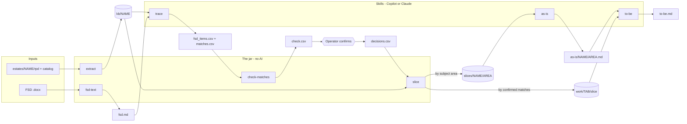
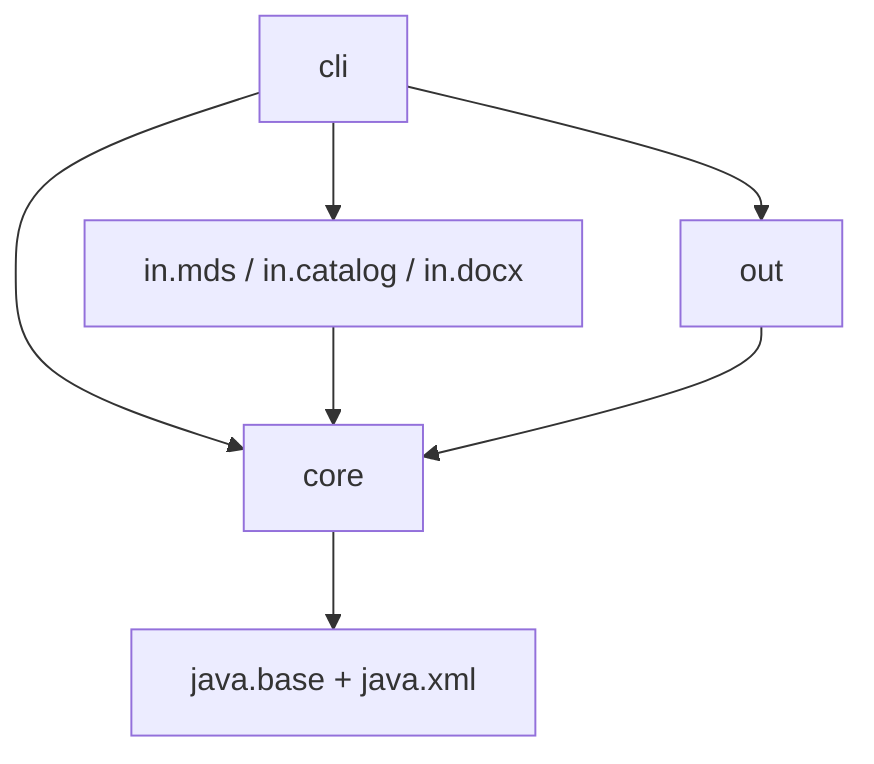
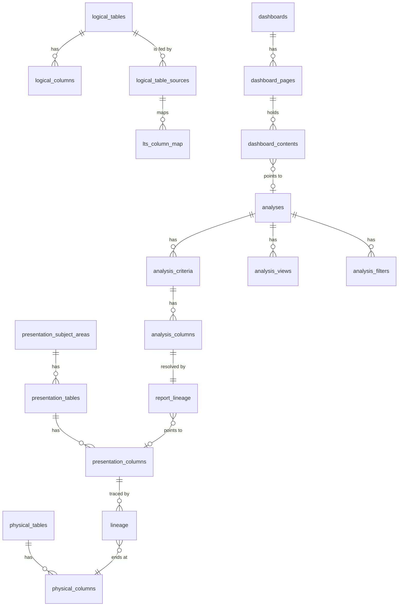

# Architecture Spine — POC-OBIEE-2-PBI phase 1

Lines marked `[ASSUMPTION]` are Winston's inference and need Kamal's yes or no.

**Reference implementation.** The Knowledge Base half of the jar (`extract`, and the starting point for `slice`) is a port of the first attempt's Python extractor. `docs/port-guide/` records what that program reads, the tables and columns it writes, and its rules. Where this spine and the port guide differ, this spine wins; the differences are that the `_guarded` columns are dropped (AD-8) and the estate name takes the place of `rpd-id` (AD-4).

## Design Paradigm

**Pipes and filters over a file blackboard.** Every stage reads files and writes files. No stage calls another, and nothing is shared in memory. The operator runs the stages in order.

There are two chains. The first needs no FSD: extract, slice by subject area, as-is skill. It produces today's semantic model, once per subject area. The second starts from an FSD and ends in the to-be design, reusing those as-is documents.

**Ports and adapters inside the jar.** Readers turn a source format into the core model; the core does lineage, slicing and checking; writers turn the model into CSV and markdown.



| Layer | Package | May depend on |
| --- | --- | --- |
| Command line | `obi2pbi.cli` | everything below |
| Inbound adapters | `obi2pbi.in.mds`, `obi2pbi.in.catalog`, `obi2pbi.in.docx`, `obi2pbi.in.kb` | `core` |
| Outbound adapters | `obi2pbi.out` | `core` |
| Core | `obi2pbi.core` | Java standard library only |

## Invariants & Rules



### AD-1 — The file system is the boundary between the jar and the skills

- **Binds:** all FRs, NFR-3
- **Prevents:** a skill correcting extracted data in place, and the correction vanishing on the next extract.
- **Rule:** the jar never calls an AI service. A skill never writes into `kb/` or a `slice/` folder. A skill that finds the Knowledge Base wrong says so in its output; the fix goes into the jar or the export.

### AD-2 — Every file in a work folder has exactly one writer

- **Binds:** FR-8 to FR-16
- **Prevents:** two stages overwriting each other's output.
- **Rule:** the writer of each file is fixed by the table under *Structural Seed*. A stage that needs to add to another stage's file writes its own file instead.

### AD-3 — The jar never guesses, and it finds unread content by observation

- **Binds:** FR-1, FR-2, FR-6
- **Prevents:** a file reported as fully read while some of its content was dropped.
- **Rule:** adapters read XML only through one recording wrapper. After each source file, the wrapper reports every attribute, element and text node that was present and not read; those go to `unparsed.csv`. No hand-kept list of "what we read" exists. Anything that should have been captured and was not (bad XML, a reference that does not resolve, a duplicate identifier) goes to `errors.csv`. The two files are never merged.

### AD-4 — Row identifiers are built one way

- **Binds:** FR-7, FR-10, FR-13 to FR-16
- **Prevents:** the jar and a skill naming the same row differently.
- **Rule:** `<estate>::<layer>::<qualified name>`, with layer one of `phys`, `bmm`, `pres`, `cat`. The qualified name is built from object names, parent first, joined by `.`. It is never built from a GUID, a file name, a timestamp or a hash. `<estate>` is the estate folder's name, lower-case with hyphens. If two objects produce the same identifier, both are written and an `errors.csv` row of kind `duplicate_identifier` is added.

### AD-5 — Source text is kept exactly, in every form the source holds

- **Binds:** FR-3, FR-15
- **Prevents:** a builder keeping only the readable form of a formula and discarding the form that is authoritative.
- **Rule:** an expression is written character for character, with no trimming. Where the source holds several forms (in MDS XML: the template, the rendered text, and the reference list), each form gets its own column.

### AD-6 — Formats are understood only in inbound adapters

- **Binds:** FR-1, FR-2, FR-9
- **Prevents:** XML or zip details spreading into lineage, slicing and checking.
- **Rule:** `core` holds no XML, zip or file-path types. Each source format has one adapter package. A new format is a new adapter and does not change `core`.

### AD-7 — A repository and a catalog are paired only by sharing an estate folder

- **Binds:** FR-5
- **Prevents:** two halves from different OBIEE instances being joined because names happen to match.
- **Rule:** the jar links report columns to presentation columns only within one estate. The link is written to its own table, `report_lineage.csv`, with a `resolution` column giving the outcome or the reason for none. `lineage.csv` holds repository lineage only and is never widened to carry report columns.

### AD-8 — One CSV contract

- **Binds:** FR-1 to FR-8, FR-11, NFR-4, NFR-5
- **Prevents:** two writers producing CSV that differs in quoting, order or encoding, which would break byte-identical reruns.
- **Rule:** all CSV is written by one writer class: UTF-8 without a byte-order mark, RFC 4180 quoting, `\n` line ends, a header row, columns in a fixed declared order, rows sorted by row identifier. Every output folder has a `manifest.csv` listing its tables; readers take the table list from the manifest, not from the directory. No time stamp appears in any table except `manifest.csv`. Every Knowledge Base and Slice also describes itself: `schema_tables.csv` has one row per table (what the table is, what one row means, its key, its layer) and `schema.csv` has one row per column (its meaning, whether it is the key, the table and column it refers to, and a note on anything to know before joining). Both are generated from the same table definitions the writer uses, so they cannot drift from the data. A skill or person who needs to query the tables starts from these two files.

### AD-9 — A Slice has the Knowledge Base's shape

- **Binds:** FR-8, FR-13 to FR-16
- **Prevents:** skills needing one reader for the Knowledge Base and another for a Slice.
- **Rule:** a Slice is a folder with the same file names and columns as the Knowledge Base and fewer rows, plus its own `manifest.csv`, `errors.csv` and `unparsed.csv` limited to the rows inside it. A Slice cut by subject area and a Slice cut by confirmed matches follow the same rules and differ only in their starting columns.

### AD-10 — The jar gives every part of the FSD an anchor

- **Binds:** FR-9, FR-10, FR-11, FR-16
- **Prevents:** the trace skill and the check disagreeing about which part of the FSD a Match refers to.
- **Rule:** `fsd-text` writes `fsd.md` with an anchor on every paragraph (`[p12]`) and every table cell (`[t3.r2.c1]`), numbered in document order. `fsd_items.csv` and `matches.csv` refer to the FSD only by anchor.

`[ASSUMPTION]` "Every FSD item has a row" (FR-11) is checked against `fsd_items.csv`, which the trace skill writes. Whether that list covers the whole FSD is for the operator to judge; the jar cannot know what counts as an item.

### AD-11 — The Match table is a fixed contract, and only the operator confirms

- **Binds:** FR-10, FR-11, FR-12, FR-8
- **Prevents:** a skill confirming its own proposal, and stages reading different columns.
- **Rule:** `matches.csv` is written by the trace skill only, with columns `item_id, fsd_anchor, fsd_text, row_id, confidence, basis, status`. `status` is `proposed` or `unmatched`. `confidence` is a whole number from 0 to 100. The operator's verdicts go in a separate file, `decisions.csv`, with columns `item_id, decision, row_id, note`; `decision` is `confirmed` or `rejected`, and `row_id` lets the operator correct the column. `slice` and the later skills read `decisions.csv` and use confirmed rows only.

### AD-12 — One citation form

- **Binds:** FR-13 to FR-16
- **Prevents:** each skill citing rows its own way, which would rule out checking citations by program later.
- **Rule:** a skill-written document cites a Knowledge Base row as `[kb:<row identifier>]`, placed at the end of the statement it supports. A statement that rests on a user's answer cites `[answer:Q<n>]` instead.

### AD-13 — One agent starts the skills; skills need three abilities and live in both clients' folders

- **Binds:** FR-17
- **Prevents:** a skill that works in one client and is missing or broken in the other.
- **Rule:** one agent, `obiee-migration-agent`, starts every skill. It is wired like the BMad developer agent: `.github/agents/obiee-migration-agent.agent.md` for GitHub Copilot, which loads the agent's `SKILL.md` from `.agents/skills/`, and the same skill under `.claude/skills/` for Claude. The agent shows a menu and runs the chosen skill; it may run the jar's commands. Neither the agent nor a skill depends on BMad's scripts, Python or `uv`. A skill may only read a file, write a file, and run a local command. It names no client-specific tool. Each skill is authored once under `skills/<name>/` and copied unchanged to `.agents/skills/<name>/` (GitHub Copilot) and `.claude/skills/<name>/` (Claude). A test fails if the copies differ. Each skill begins by listing its input files and stops with a message if one is missing.

### AD-14 — One jar, seven commands, shared behaviour

- **Binds:** FR-1 to FR-9, FR-11, NFR-2, NFR-4
- **Prevents:** each command inventing its own flags, exit codes and clean-up rules.
- **Rule:** the commands are `extract`, `slice`, `assemble-doc`, `check-doc`, `fsd-text`, `find-columns` and `check-matches`. `assemble-doc` joins the section files a skill has written into the document, the same way on every operating system, and refuses to overwrite a document holding a typed answer that is not yet recorded. Exit codes: `0` success, `2` wrong usage, `3` the run finished and found problems (`errors.csv` not empty, or a Match failed). A command rewrites its whole output folder on each run and refuses to empty a folder that has no `manifest.csv` written by this jar.

### AD-15 — No build tool and no test library

- **Binds:** NFR-1, NFR-2
- **Prevents:** a builder adding a dependency that the target system cannot fetch.
- **Rule:** the jar is built by `build.sh` or `build.cmd`, which call `javac --release 11` and `jar`. The jar's code uses only `java.base` and `java.xml`. Tests are plain Java classes run by a small runner kept in this repository.

`[ASSUMPTION]` The jar may be built on the development machine or on the target system, and the target system may be Windows. That is why there are two build scripts.

### AD-16 — Open questions and answers have one shape

- **Binds:** FR-13 to FR-17
- **Prevents:** each skill asking and remembering in its own way, and a user's answer being lost or rewritten when a document is regenerated.
- **Rule:** every skill-written document ends with an Open questions section: numbered questions, each with why it matters, how to get the answer, and an empty `Answer:` line. "How to get the answer" is a concrete step the user can take: what to look at or run and where (for example a screen in the OBIEE Administration Tool, a query against a named table, a named database object's definition, or a specific document), and what to bring back. Answers are kept in an answers file beside the document (`<name>.answers.md`). A skill adds an answer there when the user gives one and never changes or removes an existing answer. Every run reads the answers file before writing.

### AD-17 — Skills work in a small context, one unit at a time

- **Binds:** FR-8, FR-10, FR-13 to FR-17
- **Prevents:** a skill that works on a small sample and fails, or silently drops content, on a real subject area because the model's context filled up. In production the skills run in GitHub Copilot with GPT-5.6 Sol, treated here as a short-context model.
- **Rule:** no skill step reads a whole Knowledge Base, a whole Slice, or a whole document. The jar does the joining and cutting: `slice` writes `units.csv` (the list of work units, in order) and one **packet** per unit under `packets/`, a small text file holding everything about that unit already joined. A skill takes one unit, reads its packet, writes that unit's section by appending to the output file, and records the unit as done in `progress.csv` beside the output. It can stop and resume at any unit. Questions raised along the way are appended to the answers-and-questions files, never held in memory. To look something up, a skill runs a jar command that returns a few rows (`find-columns`), and does not open a CSV file. A packet is at most 400 lines; a unit larger than that is split by the jar. Skill files are short: the agent file under 150 lines, each skill under 300.

`[ASSUMPTION]` The 400-line packet limit and the file-length limits are Winston's working figures, to be tuned on the first real run in GitHub Copilot.

### AD-18 — Nothing an AI wrote goes to users unreviewed

- **Binds:** FR-10, FR-13 to FR-17, FR-19
- **Prevents:** a fluent, wrong document being handed to people who will build from it, and each skill inventing its own idea of "checked".
- **Rule:** every skill output starts with a status line, `Status: draft, not reviewed`. One review skill goes through the output again against its inputs, one unit at a time, reading the input before the output; it logs each finding to `<output>.review.csv`, corrects clear errors, and turns what it cannot settle into an open question. The status becomes `Status: reviewed <date>` only when every unit has been reviewed and `check-doc` passes afterwards. The agent presents an output as ready for users only when its status is reviewed. The review never changes a user's recorded answer.

## Consistency Conventions

| Concern | Convention |
| --- | --- |
| Table and column names | `snake_case`; tables are plural nouns (`logical_columns.csv`); the key column is `row_id`; a reference to another table is `<thing>_id` |
| Empty values | An empty cell means "the source had nothing". "Not read" is never an empty cell; it is a row in `unparsed.csv` |
| Booleans and numbers | `true` / `false`; plain digits, no thousands separators |
| Java | Package root `obi2pbi`; one class per file; no reflection, no annotations processing |
| Errors | Adapters never throw past the command for a bad source file; they record an `errors.csv` row and continue. A wrong command line is the only thing that stops a run early |
| Messages | Commands print a short summary to standard output: counts read, skipped, errors, and the output folder |
| Skill documents | Markdown; open points are a numbered list, each with an empty `Answer:` line |

## Stack

| Name | Version |
| --- | --- |
| Java (language level and runtime on the target system) | 11 |
| JDK used to build on the development machine | OpenJDK 21, with `--release 11` |
| Java modules used | `java.base`, `java.xml` |
| Build | `javac` and `jar`, called from `build.sh` / `build.cmd` |
| Skill format | Markdown `SKILL.md`, for GitHub Copilot and Claude |
| Production AI client | GitHub Copilot with GPT-5.6 Sol |

## Structural Seed

```text
POC-OBIEE-2-PBI/
  src/main/java/obi2pbi/
    cli/            # Main and the four commands
    core/           # model, identifiers, lineage, slice, match checks; no I/O
    in/mds/         # repository reader (MDS XML)
    in/catalog/     # Web Catalog reader
    in/docx/        # FSD reader
    in/kb/          # reads a Knowledge Base or Slice folder back, for slice and check-matches
    out/            # CSV writer, Knowledge Base writer, fsd.md writer
  src/test/java/obi2pbi/   # tests and the small test runner
  src/test/fixtures/       # the first attempt's small repository fixture and its expected results; a hand-made FSD
  skills/           # obiee-migration-agent/, obiee-as-is/, obiee-review/, obiee-trace/, obiee-to-be/ - the one place skills are edited
  .agents/skills/   # copies for GitHub Copilot
  .github/agents/   # obiee-migration-agent.agent.md, which points Copilot at the agent's skill
  .claude/skills/   # copies for Claude
  docs/formats/     # the MDS XML and catalog format notes carried from the first attempt
  docs/port-guide/  # what the Python reference implementation does, for the Java port
  reference/        # assets copied unchanged from the first attempt: its Knowledge Base, test corpus notes, constructed cases, sample files, as-is document and skill
  build.sh  build.cmd
  estates/<estate>/rpd/  catalog/     # input; git-ignored
  kb/<estate>/                        # written by extract
  slices/<estate>/<subject-area>/     # written by slice, one per subject area
  as-is/<estate>/<subject-area>.md    # written by the as-is skill, one per subject area
  work/<tab>/                         # one folder per FSD
```

Writers of the files:

| File | Written by | Read by |
| --- | --- | --- |
| `slices/<estate>/<subject-area>/`, with `units.csv` and `packets/` | `slice` | as-is skill, `check-doc` |
| `progress.csv` beside each skill output | the skill that writes that output | the same skill, to resume |
| `as-is/<estate>/<subject-area>.md` | as-is skill | to-be skill, reviewers, `check-doc` |
| `<output>.review.csv` beside each skill output | review skill | users, `check-doc` |
| `as-is/<estate>/<subject-area>.answers.md` | as-is skill, adding the user's answers only | as-is skill, `check-doc` |
| `work/<tab>/fsd.docx` | Operator | `fsd-text` |
| `fsd.md` | `fsd-text` | trace skill, to-be skill |
| `fsd_items.csv`, `matches.csv` | trace skill | `check-matches`, operator |
| `check.csv` | `check-matches` | operator |
| `decisions.csv` | Operator | `slice`, to-be skill |
| `work/<tab>/slice/` | `slice` | to-be skill |
| `to-be.md` | to-be skill | reviewers |

Knowledge Base tables at cold start; the code owns the list from then on:



The full table list and every column are in `docs/port-guide/`. Table and column names are the reference implementation's, so an analysis (OBIEE's word for a report) keeps the name `analyses`. Run tables: `manifest`, `errors`, `unparsed`, `coverage`, `coverage_summary`, `catalog_versions`.

## Capability → Architecture Map

| Capability | Lives in | Governed by |
| --- | --- | --- |
| FR-1 Read the repository | `in.mds`, `out` | AD-3, AD-5, AD-6, AD-8 |
| FR-2 Read the Web Catalog | `in.catalog`, `out` | AD-3, AD-6, AD-8 |
| FR-3 Keep formulas exactly | `in.*`, `out` | AD-5 |
| FR-4 Record lineage | `core` | AD-4, AD-7 |
| FR-5 Link report columns to the repository | `core` | AD-7 |
| FR-6 List what was not read | `in.*` recording wrapper, `out` | AD-3 |
| FR-7 Stable row identifiers | `core` | AD-4, AD-8 |
| FR-8 Cut a Slice | `core`, `cli` | AD-9, AD-11, AD-14 |
| FR-9 Turn the FSD into text | `in.docx`, `out` | AD-6, AD-10 |
| FR-10 Propose Matches | `skills/trace` | AD-1, AD-10, AD-11, AD-13 |
| FR-11 Check Matches | `core`, `cli` | AD-10, AD-11, AD-14 |
| FR-12 Operator confirms | `decisions.csv` | AD-2, AD-11 |
| FR-13 As-is document | `skills/as-is` | AD-1, AD-9, AD-12, AD-13 |
| FR-14 to FR-16 To-be design | `skills/to-be` | AD-1, AD-9, AD-12, AD-13 |
| FR-17 Agent and skills run in both clients | `skills/`, `.agents/skills/`, `.claude/skills/`, `.github/agents/` | AD-13, AD-16 |
| FR-18 Check a document | `core`, `cli` | AD-12, AD-14 |
| NFR-1, NFR-2 | `build.sh`, `build.cmd` | AD-15 |
| NFR-4 Rerun gives the same result | all commands | AD-8, AD-14 |

## Deferred

- **Checking that every statement carries a citation.** `check-doc` checks coverage and that citations exist. It does not check that each sentence has one; that stays a spot check (SM-3).
- **Spreadsheet-safe CSV.** A cell starting with `=`, `-`, `+` or `@` can be altered when a spreadsheet opens and saves the file. Phase 1 writes plain CSV and says so in the README; a guarded export is added only if the operator starts editing Knowledge Base files in a spreadsheet.
- **Target platform for the new tables and views.** The to-be skill stays platform-neutral until PRD open question 2 is answered.
- **Committing fetched samples and generated output.** Licence is not a constraint (owner, 2026-11-23). `estates/`, `kb/` and `slices/` are git-ignored because they are large or generated; `reference/`, `as-is/` and `work/` are kept in version control.
- **Chaining the stages.** The operator runs each command and skill by hand. A wrapper that runs them in order waits until the stages are stable.
- **Catalog object types the reference implementation does not read** (prompts saved as separate view objects, Visual Analyzer projects, scorecards, KPIs, actions, agents). They are counted in `unparsed.csv` and not modelled.
- **Stages 8 to 11 of the migration plan** (building tables, generating Power BI files, comparing numbers, sign-off).
