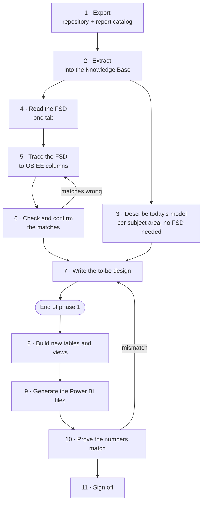

# Migration plan — OBIEE to Power BI (reboot)

**What this covers:** how one dashboard tab goes from an FSD to a signed-off Power BI report: the stages, what each hands to the next, and what stops a stage being called done.
**Who it is for:** anyone who needs the whole picture without reading the PRD or the code.
**What it is not:** a schedule. It carries no dates or effort figures.

It replaces the first attempt's plan (POC-RPD, 18 November 2026). The stages are largely the same. Two things changed: today's semantic model is described straight from the Knowledge Base as the first result, and each tab's work then starts from an FSD.

## 1. The plan in one paragraph

We export the OBIEE repository and report catalog once, and a jar reads them into a set of tables, the **Knowledge Base**, with no AI involved. From the Knowledge Base a skill describes **today's semantic model**, one subject area at a time; this needs nothing else and is the first result. After that the work goes one dashboard tab at a time. Each tab starts from an **FSD** that says what the new report is going to be. A skill traces the FSD to the OBIEE columns behind it, a check and a person confirm those matches, and a skill writes the **to-be design**: the new tables and views, the Power BI model, and the tab's fields. That is the end of phase 1. Later stages build the tables, generate the Power BI files, and compare every number with OBIEE. **Nothing counts as migrated until its numbers match.**

## 2. The stages



| # | Stage | Done by | What comes out | Done when |
|---|---|---|---|---|
| 1 | **Export** | OBIEE owner | The repository as MDS XML files and the report catalog as a folder | Both come from the **same** OBIEE instance |
| 2 | **Extract** | The jar | The Knowledge Base, plus a list of errors and a list of content not read | The error list is empty or every entry is explained; the not-read list has been looked at |
| 3 | **Describe today's model** | The jar (slice), then a skill | An as-is document for one subject area: today's semantic model in plain language, with numbered open points | Every statement cites a Knowledge Base row; every gap is an open point |
| 4 | **Read the FSD** | The jar | The FSD as plain text | Headings and tables came through intact |
| 5 | **Trace the FSD** | Skill | A match table: each FSD item, the OBIEE column proposed for it, a confidence score | Every FSD item has a row, matched or unmatched |
| 6 | **Check and confirm** | The jar, then the operator | The match table with each row confirmed or rejected | The check reports no failures and the operator has decided every row |
| 7 | **To-be design** | The jar (slice), then a skill | The design: new tables and views, Power BI model, the tab's fields | Someone who knows OBIEE finds it correct enough to build from |
| 8 | **Build new tables and views** | Data Engineering | Table and view scripts, and a signed list of *this old column is that new column* | Data Engineering has signed every table and every row of the list |
| 9 | **Generate** | Skill | Power BI project files, as text | They open in Power BI Desktop without repair |
| 10 | **Prove** | Skill, with database access | A list of checks: passed, failed, could not run | Zero failures, or a recorded override with a reason |
| 11 | **Sign off** | Report owner | Old and new side by side, with the number checks | The report owner accepts it |

Stages 1 to 7 are phase 1 and are specified in the PRD. Stages 8 to 11 are carried over from the first attempt's plan and will be planned in detail after phase 1 has run on a real tab.

### Stage notes

**1 · Export.** One-time, and nothing afterwards needs a running OBIEE server. Section 3 gives the commands.

**2 · Extract.** A program, not an assistant. It keeps formulas character for character and never guesses. Anything it cannot read is listed.

**3 · Describe today's model.** Done once per subject area, straight from the Knowledge Base. It does not wait for an FSD, so it can start as soon as extraction works, and a second tab on the same subject area reuses it.

**5 · Trace.** This is the step with the most judgement in it. A matching name does not prove the same meaning, so the skill only proposes.

**6 · Check and confirm.** The check is mechanical: the cited row exists, lineage reaches a database table, no FSD item is missing, and the matches agree with the existing report where the catalog has one. It cannot tell whether a match means the right thing. The operator decides that.

**7 · To-be design.** A document, built on the confirmed matches and on the as-is documents for the subject areas the tab touches. It marks what OBIEE cannot tell us (keys, decimal places, whether a column may be empty) as missing; Data Engineering fills those in at stage 8.

**10 · Prove.** Because the tables are new as well as the reports, a matching number has to show two things at once: the new tables hold the same data, and the new model calculates the same result.

## 3. How we get the files out of OBIEE

Stage 1 needs two things from the same OBIEE instance: the repository and the report catalog. Both are one-time exports. The commands below were worked out and checked during the first attempt.

### The repository

OBIEE keeps the repository in one binary `.rpd` file, which the jar cannot read. It has to be exported as **MDS XML**, which is one XML file per object. There are two ways.

**Command line**, with `biserverxmlgen`. It ships with the OBIEE server and with the BI client tools, usually under `ORACLE_HOME/bi/bifoundation/server/bin`.

```sh
biserverxmlgen -R <repository>.rpd -D <output-folder> -M -8
```

| Flag | Meaning |
|---|---|
| `-R` | The source `.rpd` file |
| `-D` | The output **folder**; this is what gives one file per object |
| `-M` | MDS XML format |
| `-8` | UTF-8 output |

- **Use `-M` and `-D` together.** Either one alone gives a single large file in a format the jar does not read.
- **Never add `-Q`.** It leaves out every security object, with no warning, so roles and row-level filters are lost.
- **Leave out `-P`.** Let the tool ask for the repository password, so it does not end up in the command history.

**Administration Tool**: open the repository **offline**, then **File → Save As → MDS XML Documents** and choose a folder. The option is not offered when the repository is open online.

The result is right when the output folder contains `oracle/bi/server/base/` with one sub-folder per object type (`PhysicalTable`, `LogicalTable`, `PresentationCatalog`, and so on).

### The report catalog

The catalog needs no conversion. Either of these works:

- Copy the catalog folder from the server as it is.
- Archive it with `runcat.sh`, found under `DOMAIN_HOME/bitools/bin`, and unpack the archive.

Catalog objects are files with no extension, mixed in with images and templates. Copy everything; the jar sorts out which files are catalog objects.

### If all you can get is a BAR file

A BAR (BI archive) is a zip holding both halves from one instance, which guarantees they match. It still needs one step:

| Inside the BAR | What to do |
|---|---|
| `content/catalog/` | Use as it is |
| `datamodel/rpd/default.rpd` | Still binary; run `biserverxmlgen` on it as above |

### How to hand the files over

Put both halves in one folder, named for the estate:

```
my-estate/
  rpd/       oracle/bi/server/base/...
  catalog/   ...
```

Putting them in one folder is how we state that they belong together. The jar never works that out by itself.

Also note down the **OBIEE version** the export came from. A different version shows up as extra entries in the not-read list, so it helps to know what to expect.

## 4. What is done once, and what repeats

| How often | Work |
|---|---|
| **Once per estate** | Export · extract |
| **Once per subject area** | Describe today's model. Every tab on that subject area reuses it |
| **Once per tab (one FSD)** | Read · trace · check and confirm · to-be design · generate · prove · sign off |

## 5. What we need from others

| Ask | From | Unlocks | Without it |
|---|---|---|---|
| A sample FSD | FSD author | Building and testing the trace skill | The skill is designed on a guess at what FSDs contain |
| Repository export and report catalog, **same instance** | OBIEE owner | A real test of everything in phase 1 | Phase 1 is only proven on public sample data, where the two halves do not link |
| Target platform and naming rules | Data Engineering | A to-be design specific enough to build from | The design stays generic |
| Read-only database access, old and new | Database owner | Stage 10 | **Nothing can be proven** |
| Power BI Desktop | Power BI owner | Stages 9 and 10 | No way to open or query what was generated |

## 6. Where we are today

*Updated 24 November 2026, after the unattended build. Details: `documents/implementation-artifacts/build-report.md`.*

| Stage | State |
|---|---|
| 1 Export | Not done for our own OBIEE. Development used public sample data: two repositories and one catalog, from different systems |
| 2 Extract | **Built.** A Java 11 jar with no added libraries; a port of the first attempt's extractor, extended with keys, join paths and full database tables. Compared with the first attempt's Knowledge Base on the same input: 0 unexplained differences. **Waiting for Kamal's confirmation** of the comparison report |
| 3 Describe today's model | **Built and run.** Sample Sales described, independently reviewed, every required row covered; a second subject area with row-level security also written |
| 4 Read the FSD | **Built.** Tested on an invented FSD; no real FSD yet |
| 5 Trace | **Built and run** on the invented FSD; its review caught 3 of 3 planted wrong matches |
| 6 Check and confirm | **Built.** No real decisions yet; the to-be test used decisions written by the build agent and labelled as such |
| 7 To-be design | **Built and run** on the test decisions; reviewed. Not for use: the decisions are not real |
| 8 to 11 | Not started |

The central claim, that migrated numbers match, is **unproven**. No migrated number has been compared with a legacy one, and nothing has yet been run in GitHub Copilot with GPT-5.6 Sol.

## 7. Order of work

1. Build extract for the repository and the report catalog, as a port of the first attempt's extractor.
2. Build slice and the as-is skill, and describe one subject area. This is the first result.
3. Build the FSD reader and the trace skill against a sample FSD.
4. Build the match check, then the to-be skill.
5. Run one FSD end to end. That is the end of phase 1.
6. Repeat on a real export as soon as one is available.
7. Then plan stages 8 to 11.

## 8. Risks

| Risk | Why it matters | What limits it |
|---|---|---|
| A wrong match is confirmed | The whole design for that field is built on the wrong column | The check, the confidence score with its reason, and the operator's decision |
| A gap in extraction goes unnoticed | A missing filter gives a plausible, wrong number | Everything not read is listed; the number check at stage 10 is the final net |
| The sample models are clean and the real estate is not | Works in rehearsal, fails on arrival | Test on a real export as early as possible |
| Scope grows again | The first attempt never finished | Phase 1 has one finish line: one FSD to one to-be design |
| "Same as the old report" is heard as pixel-identical | A correct migration is rejected over a font | Sign-off claims the same structure and data, not the same look |

## 9. Open decisions

1. **Which tab goes first?** It needs an FSD and, ideally, an existing OBIEE report to compare against.
2. **Which platform are the new tables and views built on?** The first attempt's plan said Azure; confirm that still holds, and whose naming rules apply.
3. **Do the new tables keep today's shape, or is the model redesigned on the way?** A like-for-like copy is mechanical; a redesign needs its own rules.
4. **Who reviews the as-is document and the to-be design** when the operator wrote them with the skills?
5. **How will the old numbers be obtained for stage 10**, and for how long will OBIEE stay available to compare against?
